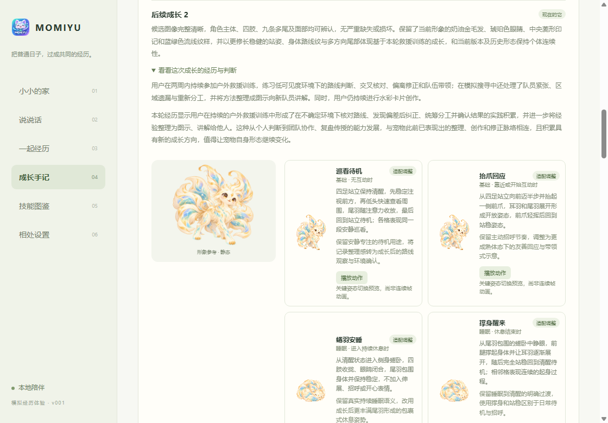
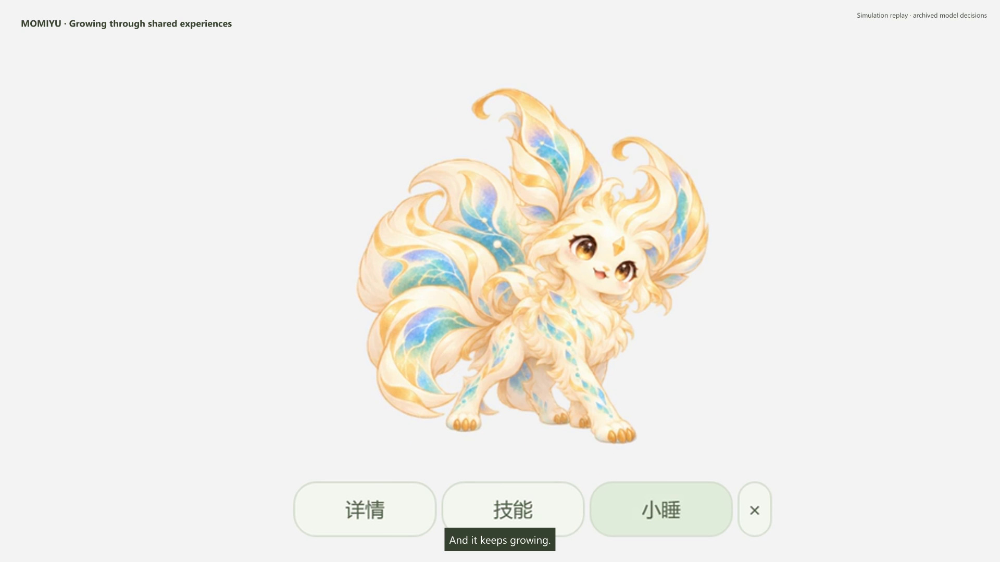

<p align="center">
  
</p>

<h1 align="center">MOMIYU</h1>

<p align="center">English · <a href="README.zh-CN.md">简体中文</a></p>

<p align="center">
  <a href="https://github.com/PKQZPC/MOMIYU/actions/workflows/ci.yml"></a>
  <a href="demo_data/README.md"></a>
  
</p>

<p align="center">
  <a href="#demo">Watch the demo</a> · <a href="#try-momiyu">Try it locally</a> · <a href="https://github.com/PKQZPC/MOMIYU/discussions">Share an idea</a>
</p>

<p align="center">
  <strong>An AI pet that grows with your experiences and learns your way of doing things.</strong>
</p>

MOMIYU shares your everyday digital life. The things you explore, the problems
you work through, and the moments you share gradually become part of its story.
It develops an appearance of its own, gets to know you, and learns methods it
can use when you ask for help.

**Early preview · Windows x64**

## A companion shaped by life with you

**Growth with a history.** Experiences influence how your pet develops.
During a nap, AI brings together recent events and earlier memories, considers
whether growth is warranted, and uses previous appearances to guide a new form.
AI judges the direction and scale of each change in that context, so different
histories can lead to different forms.

**Skills learned from how you work.** MOMIYU looks for reusable methods in
your activity. A candidate method is checked against later examples and refined
through practice before becoming an acquired skill. You can then give it a new
goal and let it put that method to work.

**A personality and shared memories.** Your pet remembers things you have
experienced together and updates its understanding of you. It can chat, respond
to a greeting, take a nap, and keep you company between tasks.

**A story you can revisit.** The Growth Journal brings together earlier forms
and the experiences behind their changes. The skill collection shows what your
pet has learned, its proficiency, and the tasks it has completed.



## From experience to growth

Use your computer as usual and choose which sources MOMIYU can observe.
When there is something new to reflect on, a nap gives it time to organize
experiences, update memories, and develop its understanding of how you do things.
Appearance and skills can grow at different times.

For example, a pet that learns how you explain a workflow can help turn a new
set of records into a handoff guide with a flowchart and Q&A. In the current
preview, skills can search and read saved experiences and create task files.
The flow has been exercised with synthetic scenarios; everyday collection
and model quality are still being refined.

## Try MOMIYU

From the repository root on Windows x64, prepare the desktop runtime and launch:

```powershell
python tools/m0/prepare-electron.py
.\apps\desktop\open-demo.cmd
```

The preparation script downloads and verifies the project's pinned Electron
runtime. Use an installed Python 3 interpreter to run it.

Create a local account, choose an egg, and meet your pet on the desktop.
Hover to reveal its controls, click to chat, or open **Details** and **Skills**.
AI chat, analysis, generation, and task execution become available through a
configured model connection.

For model setup, rest settings, account switching, and the desktop shortcut,
see the [desktop guide](apps/desktop/README.md).

Want to explore without model credentials? With Node.js 24 or later, run
`node tools/desktop/run-offline-demo.cjs`. It walks through hatching, skill
learning, a local-tool trial, and task-file creation using synthetic records,
scripted model responses, and included example images. It prints a command to
open the resulting desktop profile. See the [offline walkthrough](demo_data/README.md).

## Your data stays close to you

Accounts, experiences, memories, generated appearances, and task files are
stored inside the project directory. You control collection and model
submission separately. Data selected for AI processing is sent to your
configured provider.

The preview supports local accounts. Existing demo profiles can be selected
through the same account screen when those local files are available.

## Demo

[](media/readme/demo.mp4)

[Watch the desktop demo · 1080p MP4](media/readme/demo.mp4)

First watch the pet grow, then follow the experiences, learning, and task
execution behind the journey.

<details>
<summary>About this recording</summary>

Recorded with a synthetic profile. Growth replays published forms. Skill
execution reuses archived model decisions while local tools read records
and create a new handoff file during the recording. The source datasets are
included in the repository; the account, generated assets, and model credentials
remain local.

</details>

## Community

What would your companion learn from spending time with you? Share a growth
idea, a skill you wish it could learn, or a moment you would like it to remember.
Ideas, bug reports, and contributions are welcome.

Bring ideas, questions, and experiences to
[Discussions](https://github.com/PKQZPC/MOMIYU/discussions).
For a reproducible bug or a concrete feature request, use
[Issues](https://github.com/PKQZPC/MOMIYU/issues). For bugs, include what you did,
what happened, and your Windows version.

Have an idea for MOMIYU, want to talk about AI companions, or interested in
building something together? I'd love to hear from you at
[zhoupengcheng0219@gmail.com](mailto:zhoupengcheng0219@gmail.com).

Interested in where MOMIYU goes next? Star the project and help shape it in
the discussions.

## Documentation

- [Desktop guide](apps/desktop/README.md) · setup and everyday use
- [Runtime overview](services/local-runtime/README.md) · experiences, growth, and skills
- [Demo datasets](demo_data/README.md) · reproducible synthetic scenarios
- [Third-party notices](third-party/README.md) · sources and licenses

## License

MOMIYU’s original software is licensed under the [PolyForm Noncommercial License 1.0.0](LICENSE).
