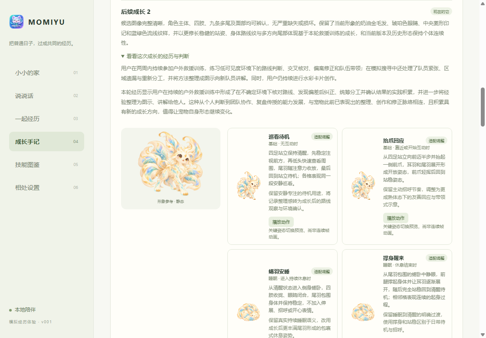
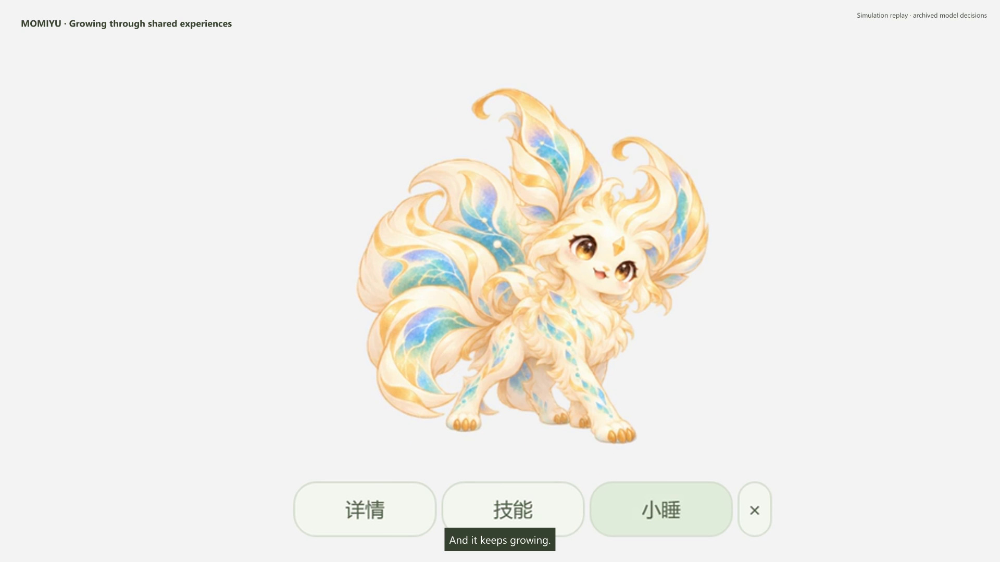

<p align="center">
  
</p>

<h1 align="center">MOMIYU</h1>

<p align="center"><a href="README.md">English</a> · 简体中文</p>

<p align="center">
  <strong>一只随共同经历成长、从你的做事方式中学习技能的 AI 宠物。</strong>
</p>

你探索过的事物、解决过的问题，还有一起度过的日常，都会逐渐成为 MOMIYU 的经历。它会长出自己的模样，慢慢了解你，也会学着用你的方法，在需要时帮上忙。

**早期预览 · Windows x64**

## 和你一起生活，长成自己的模样

**成长有迹可循。** 经历会影响宠物的发展。小睡时，AI 结合近期发生的事、过往记忆和历史形象，判断是否到了成长的时候，并在已有形象的基础上构思下一次变化。成长方向和变化幅度由 AI 结合这些线索判断，不同的经历可以走出不同的成长轨迹。你能认出一路长大的它。

**从做事方式中学会技能。** MOMIYU 会从你的活动中寻找可以复用的方法，先形成候选，再用后来观察到的案例核对，并通过练习逐步完善。等技能学会了，你可以给它一个新目标，让它真正动手帮忙。

**有自己的个性，也记得共同经历。** 宠物会记住一起经历的事，更新对你的认识。它能和你聊天、回应靠近，也会打个盹，在任务之间继续陪着你。

**过去的变化，随时可以回看。** 成长手记保留各个时期的模样和变化缘由。技能图鉴则让你看到它学会了什么、熟练到什么程度，以及已经完成的任务。



## 经历怎样成为成长

你照常使用电脑，选择允许 MOMIYU 观察的来源。有新的内容需要回顾时，它会在小睡中梳理经历、更新记忆，逐渐理解你的做事方式。外观成长和技能学习可以在不同的时候发生。

例如，它学会了你怎样把一段流程讲清楚，就能尝试把另一份记录整理成包含流程图和问答的交接说明。当前预览版的技能可以检索、读取已保存的经历，并生成任务文件。闭环已用模拟场景验证，日常采集和模型效果仍在完善。

## 开始体验

在 Windows x64 上，从仓库根目录准备桌面运行环境并启动：

```powershell
python tools/m0/prepare-electron.py
.\apps\desktop\open-demo.cmd
```

准备脚本会下载并校验项目指定的 Electron 运行时，需要使用已安装的 Python 3 执行。

创建本地账号，领取一颗蛋，就能在桌面见到它。悬停显示操作入口，点击打开聊天，也可以进入「详情」和「技能」。配置模型连接后，就能使用 AI 聊天、经历分析、形象生成和技能执行。

模型配置、休息设置、账号切换和桌面快捷方式，见[桌面使用指南](apps/desktop/README.zh-CN.md)。

想先看看完整流程，又暂时不配置模型？安装 Node.js 24 或更新版本后，运行 `node tools/desktop/run-offline-demo.cjs`。它使用仓库里的合成记录、预设模型响应和示例素材，走完孵化、技能候选、试用核对、习得及任务文件生成，并输出对应桌面档案的启动命令。详见[离线演示说明](demo_data/README.md)。

## 经历留在你身边

账号、经历、记忆、生成形象和任务文件都保存在项目目录。采集与发送给模型分别控制，允许用于 AI 处理的数据会发送给你配置的模型服务。

预览版使用本地账号。已有演示档案可以通过同一个账号入口切换，需要本机保留对应的档案文件。

## 演示

[](media/readme/demo.mp4)

[观看桌宠演示 · 1080p MP4](media/readme/demo.mp4)

先看它从蛋一路长大，再逐步了解这段成长背后的经历、技能学习和任务执行。

<details>
<summary>关于这段录制</summary>

使用模拟档案实际操作录制。成长回放已生效的历史形象；技能复用保存的模型决策，本地工具在录制中读取记录并重新生成交接文件。模拟数据随仓库提供，账号、生成素材和模型凭据保留在本地。

</details>

## 社区

如果它一直陪着你，会学会什么？欢迎分享你期待的成长、希望它掌握的技能，或想让它记住的某个时刻，也欢迎分享实际使用感受、反馈问题或参与贡献。

可以到 [Issues](https://github.com/PKQZPC/MOMIYU/issues) 参与讨论或反馈问题。反馈 bug 时，请说明操作步骤、实际结果和 Windows 版本。

对 MOMIYU 有新想法，想聊聊 AI 宠物，或希望一起做些有趣的东西？欢迎给我写信：[zhoupengcheng0219@gmail.com](mailto:zhoupengcheng0219@gmail.com)。很期待听到你的想法。

## 文档

- [桌面使用指南](apps/desktop/README.zh-CN.md) · 配置与日常操作
- [运行机制](services/local-runtime/README.md) · 经历、成长和技能
- [模拟数据](demo_data/README.md) · 可复现的演示场景
- [第三方声明](third-party/README.md) · 来源与许可证

## 许可证

MOMIYU 的原创软件采用 [PolyForm Noncommercial License 1.0.0](LICENSE)。
